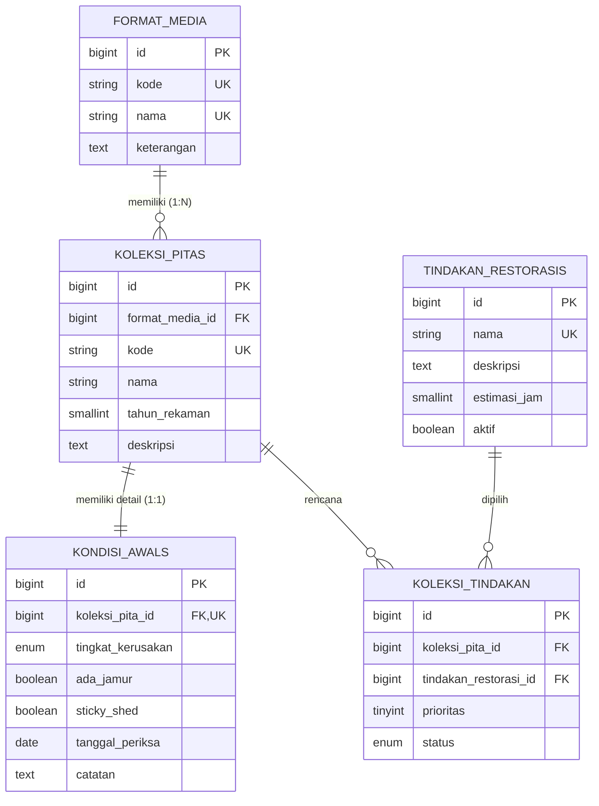

# ERD — SK04 Restorasi Pita Analog

> Render diagram ini di https://mermaid.live (tempel kode di bawah) lalu **Export PNG/PDF**,
> simpan sebagai `docs/ERD.png` (atau `.pdf`). Syarat UTS: diagram harus berupa PNG/PDF.

## Aturan delete (referential action)

| Parent dihapus | Child | Aturan | Alasan |
|---|---|---|---|
| format_media | koleksi_pitas | RESTRICT | Format yang masih dipakai koleksi tidak boleh hilang |
| koleksi_pitas | kondisi_awals | CASCADE | Detail tidak bermakna tanpa koleksinya |
| koleksi_pitas | koleksi_tindakan | CASCADE | Rencana tindakan milik koleksi ikut hilang |
| tindakan_restorasis | koleksi_tindakan | RESTRICT | Tindakan yang sudah direncanakan tidak boleh dihapus (nonaktifkan saja) |

## Constraint unik

- `format_media.kode`, `format_media.nama`
- `koleksi_pitas.kode`
- `kondisi_awals.koleksi_pita_id` → menjamin relasi **one-to-one**
- `tindakan_restorasis.nama`
- `koleksi_tindakan (koleksi_pita_id, tindakan_restorasi_id)` → tindakan tidak ganda per koleksi

## Index

- `koleksi_pitas.nama` dan `(format_media_id, nama)` → pencarian & filter daftar koleksi
- `kondisi_awals.tingkat_kerusakan` → filter kondisi
